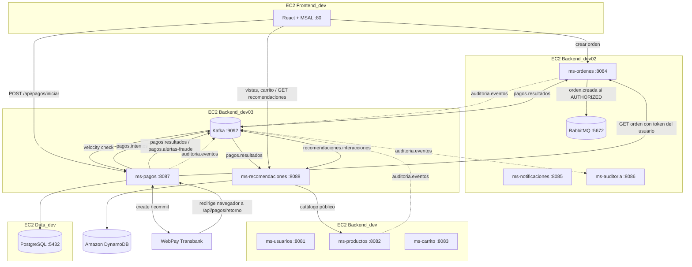

# Backend_dev03 — Pagos (WebPay + antifraude), Recomendaciones y Kafka

Tercer stack de backend de **Pedidos360**. Corre en su propia EC2 y contiene:

| Componente | Puerto | Descripción |
|---|---|---|
| **Kafka** (KRaft, sin Zookeeper) | 9092 | Broker de eventos. 5 tópicos (incluida la **auditoría**) + sus `.DLT` |
| **Kafka UI** | 8089 | Ver tópicos, mensajes y consumer groups (demo/evaluación) |
| **ms-pagos** | 8087 | Botón de pago **WebPay Plus** (Transbank) con **detección de fraude** (velocity check sobre Kafka) |
| **ms-recomendaciones** | 8088 | Servicio de **recomendaciones simple** alimentado por eventos Kafka, datos en **Amazon DynamoDB** |

> ¿Qué colas siguen en RabbitMQ y por qué la auditoría pasó a Kafka? Ver **[docs/RABBITMQ_VS_KAFKA.md](docs/RABBITMQ_VS_KAFKA.md)**.
> Mejoras y observaciones atendidas: **[docs/MEJORAS.md](docs/MEJORAS.md)**.

---

## 1. Arquitectura



### Flujo de compra completo
1. El usuario presiona **"Pagar con WebPay"** en el carrito → el frontend crea la orden en ms-ordenes (queda `PENDIENTE_PAGO`).
2. El frontend llama `POST /api/pagos/iniciar {orderId}`. ms-pagos consulta la orden en ms-ordenes **con el token del usuario** (el monto y el dueño los decide el backend, nunca el navegador).
3. **Gate antifraude:** si el cliente está bloqueado → `429`. Si no, publica el intento en `pagos.intentos` (key = clientId) y crea la transacción en WebPay.
4. El navegador se envía por `POST` (campo `token_ws`) al formulario de WebPay.
5. WebPay redirige a `/api/pagos/retorno`; ms-pagos hace `commit`, guarda el resultado y publica `pagos.resultados`.
6. **ms-ordenes** consume el resultado: `AUTHORIZED` → `PAGADA` y **recién ahí** publica `orden.creada` en RabbitMQ (stock + correo). Rechazo/anulación → `PAGO_RECHAZADO` (se puede reintentar). Cada paso queda en `auditoria.eventos` (Kafka) y se ve en la pantalla de Auditoría.
7. **ms-recomendaciones** consume el mismo evento y registra cada producto como `COMPRA`.
8. El usuario vuelve a `FRONTEND_URL/pedidos?paymentStatus=...` y ve el resultado; el carrito se vacía solo si fue `AUTHORIZED`.

### Detección de fraude (velocity check, visto en clases)
- Cada intento se publica en Kafka; el consumidor (`IntentoPagoConsumer`) lo registra y cuenta los intentos del cliente en los últimos **10 s** bajo un bloqueo de fila en PostgreSQL (seguro ante concurrencia y ante varias réplicas).
- **3 intentos en 10 s → bloqueo de 30 min** (configurable con `FRAUD_*`). Se publica `BLOQUEO_APLICADO` en `pagos.alertas-fraude`.
- Mientras dure el bloqueo, `/iniciar` responde **429** y publica `INTENTO_BLOQUEADO`.
- Idempotente: un intento re-entregado por Kafka (mismo `transactionId`) no se cuenta dos veces.
- El conteo es asíncrono (milisegundos): el intento que alcanza el umbral activa el bloqueo y **los siguientes** reciben 429.

### Recomendaciones (simple y explicable)
Pesos: `VISTA = 1`, `CARRITO = 3`, `COMPRA = 5`, con **decaimiento temporal** (vida media de 7 días).

| Endpoint | Estrategia |
|---|---|
| `GET /api/v1/recomendaciones/me` (auth) | 55 % afinidad por categoría + 25 % interés directo en el producto + 20 % popularidad. Excluye lo ya comprado y lo sin stock. Sin historial → populares. |
| `GET /api/v1/recomendaciones/populares` (público) | Suma de pesos de todos los usuarios (últimos 30 días) |
| `GET /api/v1/recomendaciones/productos/{id}/similares` (público) | Co-ocurrencia "otros clientes también lo vieron" + misma categoría |
| `POST /api/v1/recomendaciones/interacciones` (auth) | `{productoId, accion}` → Kafka (202 Accepted) |
| `POST /api/v1/recomendaciones/admin/simular?cantidad=200&usuarios=10` (Admin) | Genera tráfico aleatorio sobre el catálogo real (prueba de carga) |

Cada recomendación incluye un **motivo** legible ("Porque te interesa Notebooks", "Lo agregaste a tu carrito", …).

### Persistencia en Amazon DynamoDB (tabla única)
ms-recomendaciones guarda sus datos en la tabla `pedidos360-recomendaciones` (on-demand, se crea sola al arrancar, con TTL):

| Patrón de acceso | `pk` | `sk` |
|---|---|---|
| Historial del usuario (orden cronológico) | `USER#{usuarioId}` | `INT#{epochMillis}#{eventId}` |
| Popularidad por día (contador atómico `ADD`) | `POP#{yyyy-MM-dd}` | `PROD#{productoId}` |
| Usuarios que interactuaron con un producto | `PROD#{productoId}` | `USER#{usuarioId}` |
| Deduplicación de eventos Kafka | `EVT#{eventId}` | `EVT` |

Cada interacción se escribe en **una transacción** (`TransactWriteItems`) de 4 ítems con condición `attribute_not_exists` sobre `EVT#…`: si Kafka re-entrega un mensaje, no se duplica nada y los contadores no se inflan. El atributo `expiraEn` (TTL) borra los datos antiguos sin costo. Las credenciales vienen del rol de la EC2 (`LabInstanceProfile`): **no hay llaves AWS en el código ni en el `.env`**.

---

## 2. Tópicos Kafka

| Tópico | Key | Productor | Consumer groups |
|---|---|---|---|
| `pagos.intentos` | clientId | ms-pagos | `ms-pagos-antifraude` |
| `pagos.resultados` | orderId | ms-pagos | `ms-ordenes`, `ms-recomendaciones` |
| `pagos.alertas-fraude` | clientId | ms-pagos | (monitoreo en Kafka UI) |
| `recomendaciones.interacciones` | usuarioId | ms-recomendaciones | `ms-recomendaciones` |
| `auditoria.eventos` | id de la entidad | ms-ordenes, ms-productos, ms-pagos | `ms-auditoria` |
| `*.DLT` | — | DefaultErrorHandler | mensajes que fallaron 3 veces |

Los crea el contenedor `kafka-init` (idempotente) con 3 particiones. `auto.create.topics` está desactivado para que ningún typo cree tópicos fantasma.

---

## 3. Despliegue en AWS Academy (EC2)

### 3.1 Instancia y Security Group
- **t3.medium** o superior (Kafka + 2 JVM ≈ 2 GB). Amazon Linux 2023.
- **IAM instance profile: `LabInstanceProfile`** (obligatorio: ms-recomendaciones lo usa para DynamoDB y el despliegue para ECR/SSM).
- Reglas de entrada:

| Puerto | Origen | Para |
|---|---|---|
| 22 | Tu IP | SSH |
| 8087 | 0.0.0.0/0 | ms-pagos (navegador + retorno WebPay) |
| 8088 | 0.0.0.0/0 | ms-recomendaciones |
| 9092 | SG de **Backend_dev** y de **Backend_dev02** | Kafka para ms-productos, ms-ordenes y ms-auditoria |
| 8089 | Tu IP | Kafka UI (no dejar abierto a internet) |

En la EC2 de **Data_dev** permitir 5432 desde esta EC2; en **Backend_dev02** permitir 8084 (ms-ordenes) desde esta EC2; en **Backend_dev** permitir 8082 (ms-productos) desde esta EC2. Backend_dev03 ya **no** necesita RabbitMQ.

### 3.2 Preparar la EC2
```bash
sudo dnf install -y docker git
sudo systemctl enable --now docker
sudo usermod -aG docker ec2-user && newgrp docker
sudo mkdir -p /usr/local/lib/docker/cli-plugins
sudo curl -SL "https://github.com/docker/compose/releases/latest/download/docker-compose-linux-x86_64" \
  -o /usr/local/lib/docker/cli-plugins/docker-compose
sudo chmod +x /usr/local/lib/docker/cli-plugins/docker-compose
docker network create ecommerce-network || true
```

### 3.3 Levantar (manual)
```bash
git clone <repo> && cd Backend_dev03
cp .env.example .env
# KAFKA_ADVERTISED_HOST = IP PRIVADA de esta EC2 (curl -s http://169.254.169.254/latest/meta-data/local-ipv4)
nano .env
docker compose up -d --build
docker compose ps          # kafka healthy, kafka-init exited (0), ms-* healthy
docker compose logs -f ms-pagos
docker compose logs ms-recomendaciones | grep -i dynamo   # "Tabla DynamoDB '...' creada" o "disponible"
```

Sin AWS (en un PC), se puede usar DynamoDB Local:
```bash
docker compose -f docker-compose.yml -f docker-compose.local.yml up -d --build
```

**Si ms-recomendaciones no conecta con DynamoDB** (log *Unable to load credentials* o *No se pudo consultar DynamoDB*): la EC2 no tiene el rol `LabInstanceProfile` (EC2 → Actions → Security → Modify IAM role), o el metadata service no alcanza a los contenedores. En ese caso, desde CloudShell:
```bash
aws ec2 modify-instance-metadata-options --instance-id <ID-EC2> --http-put-response-hop-limit 2 --http-endpoint enabled
docker compose restart ms-recomendaciones
```
Para ver los datos: consola AWS → DynamoDB → Tables → `pedidos360-recomendaciones` → *Explore table items*.

### 3.4 Despliegue automático (GitHub Actions, rama `deploy`)
`.github/workflows/deploy.yml` corre los tests, construye las imágenes, las sube a ECR y despliega por **SSM** (igual que Backend_dev y Backend_dev02). Secrets requeridos:

`AWS_ACCESS_KEY_ID`, `AWS_SECRET_ACCESS_KEY`, `AWS_SESSION_TOKEN`, `EC2_INSTANCE_ID`, `KAFKA_ADVERTISED_HOST`, `DATASOURCE_URL`, `POSTGRES_USER`, `POSTGRES_PASSWORD`, `AZURE_TENANT_ID`, `AZURE_CLIENT_ID`, `CORS_ALLOWED_ORIGINS`, `ORDENES_SERVICE_URL`, `PRODUCTOS_SERVICE_URL`, `FRONTEND_URL`, `TRANSBANK_RETURN_URL` (opcionales: `TRANSBANK_COMMERCE_CODE`, `TRANSBANK_API_KEY`, `TRANSBANK_ENVIRONMENT`, `DYNAMODB_TABLE`). Los secrets `RABBITMQ_*` de este repo ya no se usan.

> En AWS Academy las credenciales expiran con cada sesión del lab: actualizar los 3 secrets `AWS_*` antes de cada push a `deploy`.

### 3.5 Cambios en los otros stacks (ya incluidos en este entregable)

| Stack | Variable / secret nuevo | Valor |
|---|---|---|
| **Backend_dev** (ms-productos) | `KAFKA_BOOTSTRAP_SERVERS` | `<IP privada Backend_dev03>:9092` |
| **Backend_dev02** (ms-ordenes, ms-auditoria) | `KAFKA_BOOTSTRAP_SERVERS` | `<IP privada Backend_dev03>:9092` |
| **Backend_dev02** | `PAGO_REQUERIDO` | `true` |
| **Backend_dev02** | `PRODUCTOS_SERVICE_URL` (ya existía) | debe incluir `/api/v1/productos`: ms-ordenes saca de ahí los precios |
| **Frontend_dev** | `VITE_MS_PAGOS_URL`, `VITE_MS_RECOMENDACIONES_URL` | URLs de API Gateway |

**Una sola vez, después de desplegar la auditoría por Kafka**, borrar la cola antigua de RabbitMQ. Ya no tiene consumidor y, como su binding es `#`, acumularía todos los mensajes sin que nadie los lea:
```bash
# En la EC2 de Backend_dev02
docker exec ecommerce-rabbitmq rabbitmqctl delete_queue pedidos360.auditoria.queue
```

**HTTPS:** si el frontend se sirve por HTTPS (API Gateway), exponer ms-pagos y ms-recomendaciones por API Gateway (integración HTTP proxy) y usar esas URLs. `TRANSBANK_RETURN_URL` debe ser la URL pública de `/api/pagos/retorno` (ruta **ANY**, **sin authorizer**).

---

## 4. Guía de prueba para la evaluación

```bash
# 1) Tópicos creados
docker exec ecommerce-kafka /opt/kafka/bin/kafka-topics.sh --bootstrap-server localhost:29092 --list

# 2) Ver eventos en vivo (otra terminal), o abrir Kafka UI en http://<IP>:8089
docker exec -it ecommerce-kafka /opt/kafka/bin/kafka-console-consumer.sh \
  --bootstrap-server localhost:29092 --topic pagos.resultados --from-beginning

# 3) Salud
curl http://<IP>:8087/actuator/health
curl http://<IP>:8088/actuator/health

# 4) Recomendaciones: generar tráfico (token de Admin) y consultar populares
curl -X POST -H "Authorization: Bearer $TOKEN_ADMIN" "http://<IP>:8088/api/v1/recomendaciones/admin/simular?cantidad=200"
curl "http://<IP>:8088/api/v1/recomendaciones/populares?limit=5"

# 5) Auditoría en vivo: cada evento muestra sus headers (tipo-evento, event-id, origen)
docker exec -it ecommerce-kafka /opt/kafka/bin/kafka-console-consumer.sh \
  --bootstrap-server localhost:29092 --topic auditoria.eventos --from-beginning \
  --property print.headers=true

# 6) Consumer groups (ms-ordenes y ms-recomendaciones leen el mismo tópico; ms-auditoria lee auditoria.eventos)
docker exec ecommerce-kafka /opt/kafka/bin/kafka-consumer-groups.sh --bootstrap-server localhost:29092 --describe --all-groups
```

**Pago en WebPay (ambiente de integración):**

| Dato | Valor de prueba |
|---|---|
| Tarjeta VISA (aprobada) | `4051 8856 0044 6623`, CVV `123`, cualquier fecha futura |
| Tarjeta Mastercard (rechazada) | `5186 0595 5959 0568`, CVV `123` |
| RUT / clave en el simulador del banco | `11.111.111-1` / `123` |

**Demostrar el antifraude:** crear 3 pedidos y presionar "Pagar con WebPay" en cada uno en menos de 10 s (o cancelar en WebPay y reintentar rápido). El siguiente intento muestra *"Detectamos demasiados intentos de pago seguidos…"* (HTTP 429), aparece `BLOQUEO_APLICADO` en `pagos.alertas-fraude` y `pedidos360.pago.bloqueado` en la pantalla de Auditoría.

---

## 5. Variables de entorno
Ver [`.env.example`](.env.example). Las principales:

| Variable | Uso |
|---|---|
| `KAFKA_ADVERTISED_HOST` | IP privada de esta EC2 (Kafka la anuncia a ms-ordenes) |
| `DATASOURCE_URL` | PostgreSQL de Data_dev, solo para ms-pagos (schema `pagos`) |
| `AWS_REGION` / `DYNAMODB_TABLE` | DynamoDB de ms-recomendaciones (por defecto `us-east-1` / `pedidos360-recomendaciones`) |
| `ORDENES_SERVICE_URL` / `PRODUCTOS_SERVICE_URL` | URLs base incluyendo `/api/v1/ordenes` y `/api/v1/productos` |
| `TRANSBANK_*` | Credenciales WebPay (por defecto, integración) |
| `TRANSBANK_RETURN_URL` / `FRONTEND_URL` | Retorno de WebPay y redirección final al frontend |
| `FRAUD_MAX_ATTEMPTS` / `FRAUD_WINDOW_SECONDS` / `FRAUD_BLOCK_MINUTES` | Umbral del velocity check (3 / 10 / 30) |

## 6. Estructura
```
Backend_dev03/
├── docker-compose.yml          # kafka, kafka-init, kafka-ui, ms-pagos, ms-recomendaciones
├── docker-compose.local.yml    # override con DynamoDB Local (solo para correr sin AWS)
├── .env.example
├── .github/workflows/deploy.yml
├── docs/
│   ├── RABBITMQ_VS_KAFKA.md    # decisión colas vs Kafka
│   └── MEJORAS.md              # observaciones y mejoras aplicadas
├── ms-pagos/                   # Webpay + antifraude (Kafka)
└── ms-recomendaciones/         # motor de recomendaciones (Kafka + DynamoDB)
```
