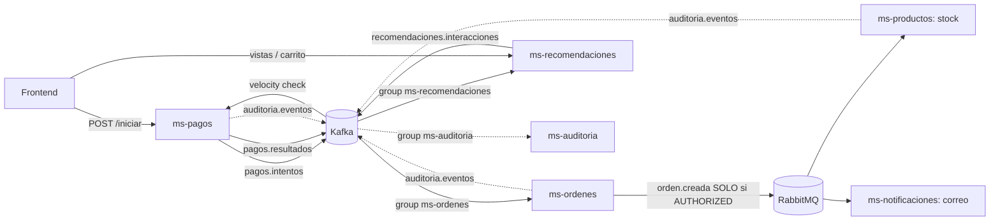

# ¿Las colas de la evaluación anterior se mantienen en RabbitMQ o se migran a Kafka?

**Respuesta corta:**

| Cola anterior (RabbitMQ) | Decisión |
|---|---|
| `pedidos360.stock.queue` | **Se mantiene en RabbitMQ** |
| `pedidos360.notificaciones.queue` | **Se mantiene en RabbitMQ** |
| `pedidos360.auditoria.queue` | **Migrada a Kafka** → tópico `auditoria.eventos` |

Los **flujos nuevos** (intentos de pago, resultados de pago, alertas de fraude, interacciones de usuario) también van en Kafka. El sistema queda con **dos brokers**, cada uno usado para lo que mejor sabe hacer.

No es una decisión de "Kafka es más moderno, migremos todo": se analizó cada cola según **qué tipo de mensaje transporta** y **qué pasaría si se reprocesa**.

---

## 1. Inventario de colas (evaluación anterior)

Todas colgaban del exchange `pedidos360.exchange` (tipo *topic*) en la EC2 de Backend_dev02.

| Cola | Routing key | Productor | Consumidor | Qué hace |
|---|---|---|---|---|
| `pedidos360.stock.queue` | `pedidos360.orden.creada` | ms-ordenes | ms-productos | Descuenta stock |
| `pedidos360.notificaciones.queue` | `pedidos360.orden.creada` | ms-ordenes | ms-notificaciones | Envía correo de confirmación |
| `pedidos360.auditoria.queue` | `#` (todo) | ms-ordenes, ms-productos, ms-pagos | ms-auditoria | Guarda cada evento en BD |

## 2. Análisis cola por cola

### `pedidos360.stock.queue` → **se mantiene en RabbitMQ**
- Es un **comando/tarea** ("descuenta N unidades del producto X") con **un único consumidor**.
- Necesita *ack* por mensaje y reentrega si ms-productos falla: es exactamente el modelo de cola de trabajo de RabbitMQ.
- El argumento decisivo: en Kafka los mensajes **se pueden volver a leer** (reset de offsets, nuevo consumer group). Reprocesar este mensaje **descontaría el stock dos veces**. La capacidad de *replay*, que es la gran ventaja de Kafka, aquí es un riesgo.

### `pedidos360.notificaciones.queue` → **se mantiene en RabbitMQ**
- También es una tarea con efecto externo (enviar un correo). Un replay **reenviaría correos** a los clientes.
- No hay orden que garantizar ni volumen alto; se beneficia de reintentos por mensaje, propios de RabbitMQ.

### `pedidos360.auditoria.queue` → **migrada a Kafka (`auditoria.eventos`)**
La auditoría es justo lo contrario de las dos anteriores:

| Característica de la auditoría | Por qué encaja en Kafka |
|---|---|
| Es un **registro inmutable** de hechos que ya ocurrieron (append-only) | Un tópico de Kafka *es* un log append-only |
| Hay que poder **reconstruirla** si se pierde la BD o se agrega un nuevo sistema de análisis | Kafka **retiene** los eventos (7 días) y se pueden releer desde el inicio |
| Si ms-auditoria se cae, no se debe perder nada | Los eventos siguen en el tópico; al volver, ms-auditoria continúa desde su último offset |
| Releer un evento no tiene efectos externos | Solo se vuelve a escribir un registro (y se descarta por `event-id` duplicado) |
| Recibe eventos de **todos** los servicios | Un solo tópico, un consumer group; nuevos consumidores (ej. un dashboard) se agregan sin tocar a los productores |

Con RabbitMQ, el binding `#` copiaba en la cola de auditoría **todo** lo que pasaba por el exchange, y una vez consumido el mensaje desaparecía: no había forma de reconstruir la auditoría.

## 3. Cómo quedó la auditoría en Kafka

```
ms-ordenes   ──┐  orden.registrada, orden.creada, orden.pagada, orden.pago-rechazado
ms-productos ──┼─► Kafka: auditoria.eventos ──► ms-auditoria ──► PostgreSQL ──► pantalla /auditoria
ms-pagos     ──┘  producto.creado/modificado/eliminado, stock.actualizado, stock.error, pago.*
```

- **Formato compatible:** el tipo de evento viaja en el header Kafka `tipo-evento` con **el mismo nombre que antes tenía la routing key** (`pedidos360.orden.creada`, `pedidos360.pago.authorized`, …) y el valor es el mismo JSON. La pantalla de Auditoría del frontend no cambió.
- **Headers:** `tipo-evento`, `event-id` (UUID) y `origen` (microservicio).
- **Idempotencia:** ms-auditoria guarda el `event-id` con índice único; un mensaje re-entregado no se duplica.
- **Después del commit:** ms-ordenes y ms-productos publican la auditoría recién cuando la transacción se confirma, así nunca se audita algo que se revirtió.
- **No bloquea el negocio:** si Kafka no responde, el evento de auditoría se registra en el log del servicio y la operación (crear orden, editar producto, pagar) sigue normalmente.
- **Más trazabilidad que antes:** ahora también se auditan la creación y eliminación de productos, el descuento de stock por producto y los errores de stock.
- ms-pagos y ms-auditoria **ya no usan RabbitMQ**.

## 4. Mapa completo de Kafka

| Tópico | Key (partición) | Productor | Consumidores (consumer group) | Por qué Kafka |
|---|---|---|---|---|
| `pagos.intentos` | `clientId` | ms-pagos | ms-pagos (`ms-pagos-antifraude`) | El *velocity check* necesita los intentos **ordenados por cliente**: la key garantiza que caen en la misma partición. Flujo de alto volumen que se puede re-procesar para recalibrar reglas. |
| `pagos.resultados` | `orderId` | ms-pagos | ms-ordenes (`ms-ordenes`), ms-recomendaciones (`ms-recomendaciones`) | **Un evento, varios consumidores independientes**, cada uno con su offset. |
| `pagos.alertas-fraude` | `clientId` | ms-pagos | Monitoreo (Kafka UI) | Stream de eventos de seguridad que conviene retener. |
| `recomendaciones.interacciones` | `usuarioId` | ms-recomendaciones | ms-recomendaciones | *Clickstream* (vistas, carrito), igual que `interacciones-user` del ejemplo CloudNative. |
| `auditoria.eventos` | id de la entidad | ms-ordenes, ms-productos, ms-pagos | ms-auditoria (`ms-auditoria`) | Bitácora inmutable y re-legible (ver sección 2). |

Cada tópico tiene su `.DLT` (dead letter topic) para mensajes que fallan repetidamente.

## 5. Cómo conviven los dos brokers



**ms-ordenes es el puente:** consume `pagos.resultados` desde Kafka y, solo cuando el pago es `AUTHORIZED`, publica `orden.creada` en RabbitMQ para descontar stock y enviar el correo.

## 6. Regla práctica usada

| Si el mensaje es… | Usar |
|---|---|
| Una **tarea** para un consumidor, con efecto externo que no debe repetirse (descontar stock, enviar correo) | **RabbitMQ** (cola de trabajo, ack, reintentos) |
| Un **hecho** que interesa a varios servicios, que conviene **retener y re-leer** (auditoría, resultados de pago), o un **stream** de alto volumen con orden por clave | **Kafka** (log particionado, consumer groups, replay) |

## 7. Comparación con el ejemplo CloudNative-Recomendaciones

- El ejemplo usa Kafka solo para `interacciones-user`; aquí se replica ese patrón (`recomendaciones.interacciones`) y se agrega el resultado de pago como señal de compra.
- Igual que el ejemplo, las interacciones se guardan en **Amazon DynamoDB** (tabla única con historial por usuario, popularidad diaria y co-ocurrencia, escritas en una transacción idempotente).
- El ejemplo usa además un modelo TensorFlow en una EC2 aparte. El requisito pide "un servicio de recomendaciones simple", por lo que se implementó un motor **explicable** en Java (afinidad por categoría con decaimiento temporal + popularidad + co-ocurrencia), con tests unitarios.
- El ejemplo deja la IP de Kafka y credenciales en un `.env` versionado y usa `@CrossOrigin("*")`; aquí todo va por variables de entorno/secrets y CORS restringido.
