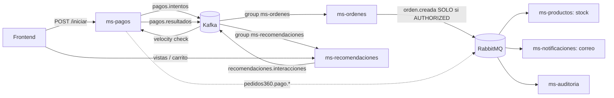

# ¿Las colas de la evaluación anterior se mantienen en RabbitMQ o se migran a Kafka?

**Respuesta corta:** las tres colas existentes **se mantienen en RabbitMQ**. Los **flujos nuevos** (intentos de pago, resultados de pago, alertas de fraude e interacciones de usuario) **se implementan en Kafka**. El sistema queda con **dos brokers**, cada uno usado para lo que mejor sabe hacer, y conectados en un solo punto (ms-ordenes).

No es una decisión de "Kafka es más moderno, migremos todo": se analizó cada cola según **qué tipo de mensaje transporta** y **qué pasaría si se reprocesa**.

---

## 1. Inventario de colas actuales (evaluación anterior)

Todas cuelgan del exchange `pedidos360.exchange` (tipo *topic*) en la EC2 de Backend_dev02.

| Cola | Routing key | Productor | Consumidor | Qué hace |
|---|---|---|---|---|
| `pedidos360.stock.queue` | `pedidos360.orden.creada` | ms-ordenes | ms-productos | Descuenta stock |
| `pedidos360.notificaciones.queue` | `pedidos360.orden.creada` | ms-ordenes | ms-notificaciones | Envía correo de confirmación |
| `pedidos360.auditoria.queue` | `#` (todo) | ms-ordenes, ms-productos, ms-pagos | ms-auditoria | Guarda cada evento en BD |

## 2. Análisis cola por cola

### `pedidos360.stock.queue` → **se mantiene en RabbitMQ**
- Es un **comando/tarea** ("descuenta N unidades del producto X") con **un único consumidor**.
- Necesita *ack* por mensaje y reentrega si ms-productos falla: es exactamente el modelo de cola de trabajo de RabbitMQ.
- El argumento decisivo: en Kafka los mensajes **se pueden volver a leer** (reset de offsets, nuevo consumer group). Reprocesar este mensaje **descontaría el stock dos veces**. La capacidad de *replay*, que es la gran ventaja de Kafka, aquí es un riesgo.

### `pedidos360.notificaciones.queue` → **se mantiene en RabbitMQ**
- También es una tarea con efecto externo (enviar un correo). Un replay **reenviaría correos** a los clientes.
- No hay orden que garantizar ni volumen alto; se beneficia de reintentos por mensaje y DLQ, propios de RabbitMQ.

### `pedidos360.auditoria.queue` → **se mantiene en RabbitMQ (candidata a migrar en el futuro)**
- Es la **única** que conceptualmente encaja mejor en Kafka: la auditoría es un **log inmutable y append-only**, y Kafka retiene los eventos y permite releerlos.
- Se mantiene en RabbitMQ en esta entrega porque funciona, ms-auditoria ya la consume con un listener genérico y el frontend (`/auditoria`) depende de ella. Migrarla no agrega funcionalidad evaluable y sí riesgo.
- Para no perder trazabilidad, **ms-pagos también publica sus eventos en este exchange** (`pedidos360.pago.iniciado|authorized|rejected|cancelled|bloqueado`), así aparecen en la pantalla de auditoría existente.
- Además, los eventos nuevos en Kafka ya quedan retenidos 7 días y se pueden inspeccionar en Kafka UI (puerto 8089).

## 3. Flujos nuevos → Kafka (y por qué)

| Tópico Kafka | Key (partición) | Productor | Consumidores (consumer group) | Por qué Kafka |
|---|---|---|---|---|
| `pagos.intentos` | `clientId` | ms-pagos | ms-pagos (`ms-pagos-antifraude`) | El *velocity check* necesita los intentos **ordenados por cliente**: la key garantiza que todos los intentos de un cliente caen en la misma partición y se procesan en orden. Es un flujo de alto volumen (cada clic en "Pagar") y se puede re-procesar para recalibrar reglas. |
| `pagos.resultados` | `orderId` | ms-pagos | ms-ordenes (`ms-ordenes`), ms-recomendaciones (`ms-recomendaciones`) | **Un evento, varios consumidores independientes**, cada uno con su propio offset. Si mañana se agrega un servicio de analítica, lee el historial desde el inicio sin tocar ms-pagos. En RabbitMQ habría que crear una cola nueva por consumidor y los eventos pasados no existirían. |
| `pagos.alertas-fraude` | `clientId` | ms-pagos | Monitoreo (Kafka UI) / futuro SIEM | Stream de eventos de seguridad que conviene retener y analizar en el tiempo. |
| `recomendaciones.interacciones` | `usuarioId` | ms-recomendaciones (REST desde el frontend) | ms-recomendaciones | *Clickstream*: muchos eventos pequeños (vistas, carrito). Mismo caso que `interacciones-user` del ejemplo **CloudNative-Recomendaciones**. |

Cada tópico tiene su `.DLT` (dead letter topic): un mensaje que falla 3 veces se aparta para no bloquear la partición.

## 4. Cómo conviven los dos brokers

**ms-ordenes es el puente:** consume `pagos.resultados` desde Kafka y, solo cuando el pago es `AUTHORIZED`, publica el mismo `orden.creada` de siempre en RabbitMQ. Los consumidores de RabbitMQ **no cambiaron una línea**, y además se corrigió un problema de negocio: antes el stock se descontaba y el correo se enviaba **antes de pagar**.

## 5. Regla práctica usada

| Si el mensaje es… | Usar |
|---|---|
| Una **tarea** para un consumidor, con efecto externo que no debe repetirse (descontar stock, enviar correo) | **RabbitMQ** (cola de trabajo, ack, DLQ) |
| Un **hecho** que interesa a varios servicios, que conviene **retener y re-leer**, o un **stream** de alto volumen con orden por clave | **Kafka** (log particionado, consumer groups, replay) |

## 6. Comparación con el ejemplo CloudNative-Recomendaciones

- El ejemplo usa Kafka solo para `interacciones-user`; aquí se replica ese patrón (`recomendaciones.interacciones`) y se agrega el resultado de pago como señal de compra.
- El ejemplo usa un modelo TensorFlow en una EC2 aparte y DynamoDB. El requisito pide "un servicio de recomendaciones simple", por lo que se implementó un motor **explicable** en Java (afinidad por categoría con decaimiento temporal + popularidad + co-ocurrencia), con tests unitarios y sin infraestructura extra. Se puede reemplazar por el modelo de TensorFlow más adelante sin cambiar los tópicos.
- El ejemplo deja la IP de Kafka y credenciales en un `.env` versionado y usa `@CrossOrigin("*")`; aquí todo va por variables de entorno/secrets y CORS restringido.
